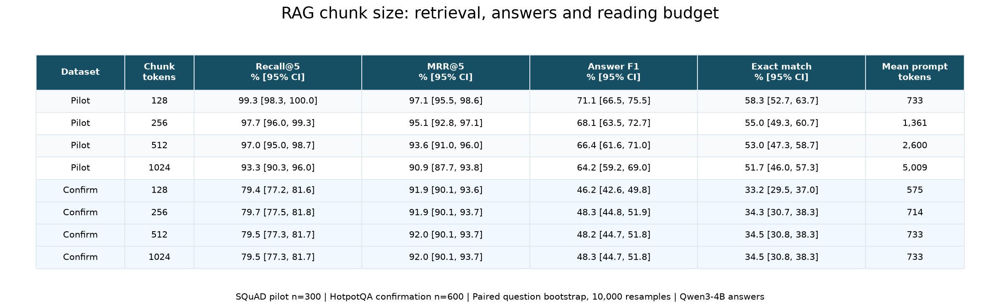
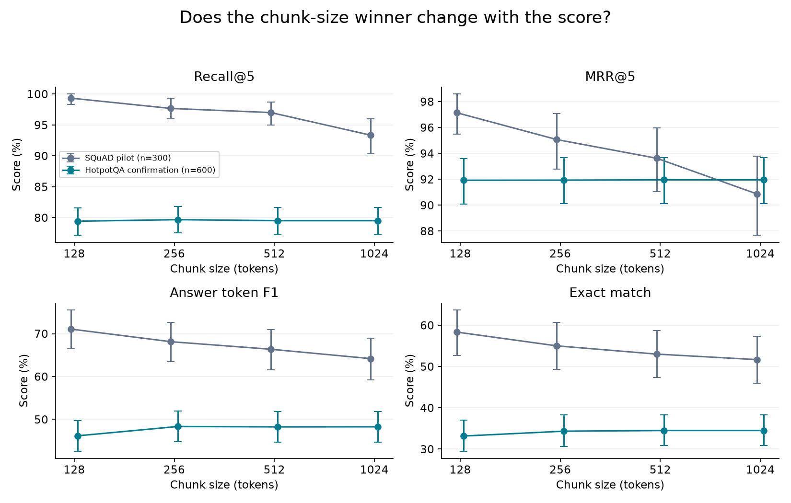
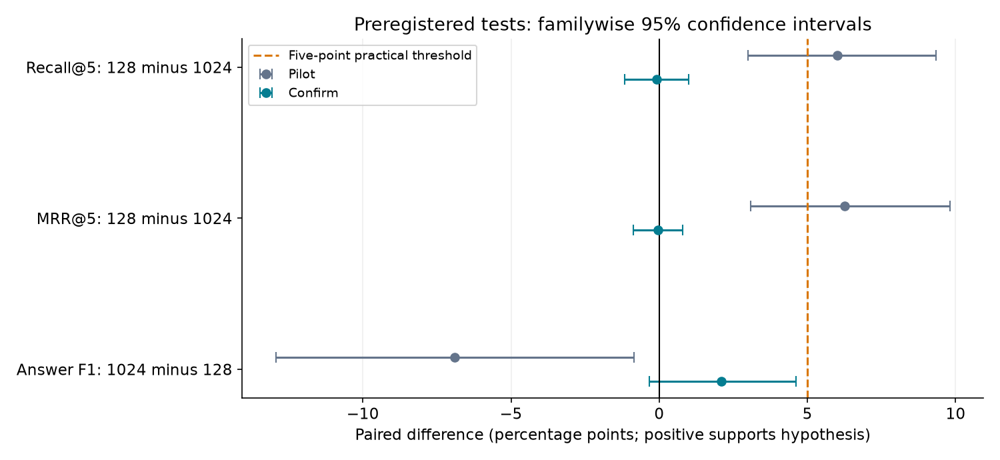
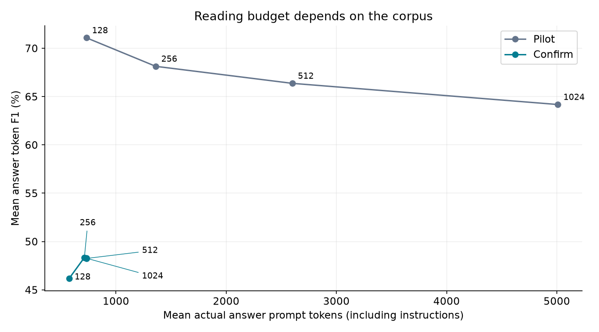

# I tested whether the best RAG chunk size changes when you score the answers

A search system can look good before anyone reads its answers. That gap is the reason I wanted to test a deceptively small RAG setting: chunk size.

My headline result is **2.1 percentage points**. That is the change in answer token F1 when I moved from 128-token chunks to 1024-token chunks on a fresh set of 600 HotpotQA questions. The verdict under my fixed decision rule is **INCONCLUSIVE**.

This run did not resolve the preregistered ranking-flip claim at the chosen confidence and practical thresholds. The observed differences are useful measurements, but they do not establish a reliable universal reversal.

The idea came from [Aqeel Abbas's article, “Which RAG Chunk Size Is Best? The Answer Flips Depending on How You Score It.”](https://medium.com/illumination/which-rag-chunk-size-is-best-the-answer-flips-depending-on-how-you-score-it-2c3ef424e50c) Its accessible preview describes the tension between precise passages and surrounding context. The detailed experiment is behind a paywall. This post builds on that question, without claiming to reproduce a method I could not inspect.

I wanted to make the prediction specific enough to fail. Before running the tests, I wrote down two claims. First, 128-token chunks would beat 1024-token chunks on retrieval Recall@5 and reciprocal rank. Second, 1024-token chunks would beat 128-token chunks on answer F1. Together, those claims would produce the proposed ranking reversal.

I also tested 256 and 512 tokens. Those intermediate settings help explain the shape of the result, but I did not let them replace the planned endpoint comparison after seeing the scores.

## What went into the test

The pilot used 300 questions from SQuAD. I combined its validation paragraphs into 48 article documents, then searched those documents for every question. To reduce repeated-context dependence, the sample contained one question per source paragraph.

The confirmation used a different dataset: 600 HotpotQA validation questions. I combined the context documents supplied with those examples into a corpus of 5,936 documents. Every question searched that whole corpus. The retriever did not get a private list of ten documents for its own question.

This is still a compact benchmark built from supplied snippets. It is not retrieval over all of Wikipedia. That distinction matters when interpreting both the scores and the meaning of a 1024-token chunk.

For each dataset, I kept documents and questions fixed across all four chunk sizes. Chunks were consecutive windows without overlap. Qwen3-Embedding-0.6B embedded the full text, and FAISS searched normalized vectors using exact inner products.

Qwen3-4B then answered from the five highest-ranked chunks. It used greedy decoding with thinking disabled and a short-answer instruction. Each answer had a maximum of 64 generated tokens. The saved records include actual input and output token counts from the model.

## What the scores say

The pilot's retrieval scores favored small chunks. Recall@5 was 99.3% at 128 tokens and 93.3% at 1024. Pilot answer F1 was 71.1% and 64.2% respectively.

On the fresh HotpotQA sample, Recall@5 was 79.4% for 128 tokens and 79.5% for 1024. Reciprocal rank was 91.9% versus 92.0%. Answer F1 was 46.2% versus 48.3%, with exact match at 33.2% versus 34.5%.

Across all four settings, the point-estimate leaders were 256 tokens for recall, 512, 1024 for reciprocal rank, and 256 for answer F1. These descriptive winners do not override the preregistered comparison.

Those are different questions about the same pipeline. Recall measures how much of the relevant document set appears among the five retrieved chunks. Reciprocal rank rewards finding a relevant document earlier. F1 compares words in the generated answer with words in the reference answer.

A crucial limitation is that my retrieval labels identify source documents. A chunk can come from the right document while omitting the sentence needed to answer. That means a strong retrieval score is not a certificate that the generator received the necessary evidence.

## How I decided what counted

I used paired bootstrap intervals, resampling questions 10,000 times. Each resample preserved the comparison between chunk sizes on the same questions.

For the three primary claims, I adjusted the intervals so their combined coverage was at least 95%. I also required a gain of at least five percentage points on every planned metric before calling the full claim proven. That threshold corresponds to one more useful result per twenty questions, a practical reason to consider changing ingestion settings.

The confirmation F1 difference had a conventional 95% interval of [0.1, 4.2] percentage points. Its simultaneous interval was [-0.3, 4.6]. The ordinary interval barely clears zero, but the adjusted interval does not. The gain also falls below the fixed five-point threshold, while the predicted retrieval advantage is absent. The verdict follows the complete preregistered rule.

## The reading budget complicates the story

Five chunks is a fixed count, but it is not a fixed amount of text. Mean confirmation prompt length rose from 575 tokens at the smallest setting to 733 at the largest. Chunk size therefore changes the generator's reading budget as well as the retrieval units.

There is another wrinkle. Many HotpotQA documents are short snippets. Increasing the maximum from 512 to 1024 does not make those documents longer. The two settings returned identical top-five document lists on 98.0% of questions. The configured chunk limit and the text actually retrieved deserve separate attention.

## A check on answer scoring

Word overlap can punish an acceptable paraphrase or reward an incomplete answer. I therefore asked Qwen to judge 60 questions per dataset at all four sizes against reference answers.

On confirmation, the judge agreed with the F1-at-least-0.5 classification 84.2% of the time. It agreed with exact match 75.4% of the time. I saved disagreements for inspection. A pilot disagreement illustrates the gap: “5” versus “five” received zero lexical F1 but was accepted by the judge. Another judge call accepted “about 11,000 years ago” against “11,700 years ago,” showing that model grading can be permissive too. This is a diagnostic from the same model family, not independent human validation.

The remaining limits are substantial: one embedding model, one answer model, one prompt, no overlap, and one fixed top-five policy. The intervals treat questions as the sampling units, even though questions can share documents. They do not measure uncertainty across model training runs. Public benchmark familiarity is also possible.

For engineers, the useful result is a measured comparison with an explicit failure condition. Check both evidence retrieval and final answers on your workload, record the actual tokens read, and inspect the document lengths before interpreting a chunk-size sweep. This experiment supplies evidence for one operating policy, with its misses left visible.

Timing: estimated 100 minutes; actual 95.2 minutes elapsed, including recovery/waiting; NVIDIA L4; at most 3.76 CU (shared-account upper bound).
