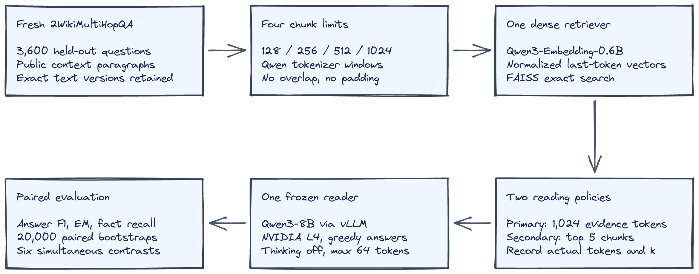
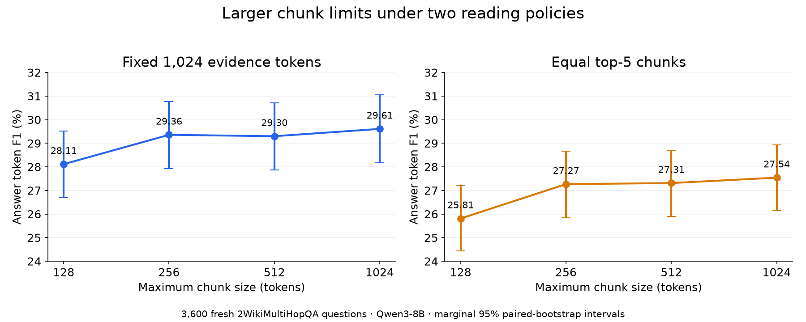
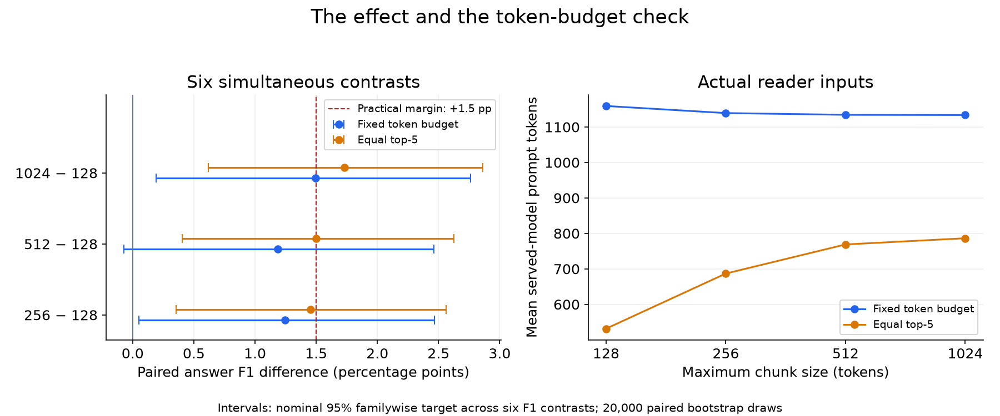
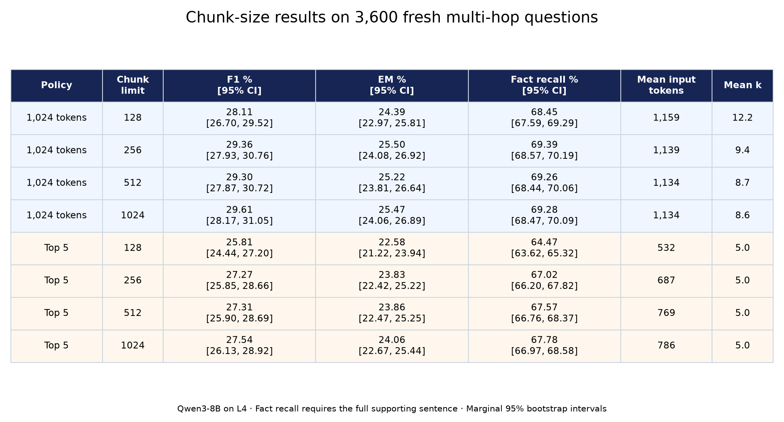

# A larger RAG chunk limit gained 1.49 F1 points at the same reading budget

*3,600 fresh multi-hop questions, a fixed evidence budget, and a follow-up designed around the effect we actually saw last time.*

Your RAG test retrieves five chunks, so you change the chunk limit from 128 to 1,024 and rerun it. Better answers might mean better evidence, or simply more text in the reader’s prompt. Those are different engineering changes behind the same setting.

[Aqeel Abbas’s article](https://medium.com/illumination/which-rag-chunk-size-is-best-the-answer-flips-depending-on-how-you-score-it-2c3ef424e50c) puts the claim neatly: “The Answer Flips Depending on How You Score It.” Its public preview also points to how much text the model gets to read. That matters when a team compares five small passages with five large ones and calls the outcome a chunking benchmark. The evidence budget may have changed alongside the search representation.

Here is my headline result: **+1.49 percentage points of answer F1** for a 1,024-token chunk limit versus 128, with both policies receiving 1,024 evidence tokens. The simultaneous confidence interval was **[+0.19, +2.76] points**. The registered verdict is **INCONCLUSIVE**.

This is experiment 132b in Tech in General’s series. The letter matters: it follows an earlier test that did not settle the question.

## Why I ran it again

Experiment 132 found a 2.1-point answer-F1 improvement on 600 HotpotQA questions. Its adjusted interval ran from minus 0.3 to plus 4.6 points. The original five-point practical threshold was missed, and the predicted retrieval ranking flip was absent.

That result suggested a smaller effect worth testing. It did not justify declaring that larger chunks win. I also learned that many benchmark paragraphs are shorter than their configured chunk limit. Calling a setting “1,024 tokens” does not mean the reader actually receives passages that long.

For the follow-up, I registered a narrower prediction before retrieval or answer generation: the large-chunk policy should improve F1 by at least 1.5 points in the observed sample, and its simultaneous interval should exclude zero. The margin represents about 15 fully correct answer equivalents per thousand requests. F1 is partial-credit scoring, so that is an intuition for scale, not a literal count of corrected answers.

## What I tested

I used 3,600 questions from the public Hugging Face dataset `cmriat/2wikimultihopqa`, validation split. These are fresh relative to the previous HotpotQA experiment. A fixed shuffle selected the questions, with 16 other questions reserved and excluded. No new reader pilot was used to tune the confirmation.

The searchable corpus contained 19,945 distinct context-paragraph versions from those questions. Every query searched that global corpus. It did not receive just its own question’s convenient set of context paragraphs. Exact title-and-text deduplication kept conflicting versions separate so supporting sentences stayed attached to the correct text.

Documents were split into nonoverlapping Qwen-tokenizer windows with maximum sizes of 128, 256, 512 and 1,024. The embedder was **Qwen3-Embedding-0.6B**, using normalized last-token vectors. FAISS performed exact inner-product search. That keeps the chunker, embedding and search family comparable with the earlier run.

The reader was **Qwen3-8B served through vLLM on an NVIDIA L4**, using FP16, greedy generation, thinking disabled and a maximum of 64 answer tokens. The earlier experiment used Qwen3-4B, so this follow-up changes both the data and reader. Only the source article’s public preview was accessible; this is an independent test. Each prompt asked for a short answer from the passages, or “unknown.”

The diagram shows where the two reading policies branch. The questions, corpus, embedder and reader stay fixed; the amount and packaging of retrieved evidence depend on the policy.

The main policy filled a 1,024-token evidence budget from the ranked chunks, trimming only the final chunk. This makes the number of retrieved chunks vary. A second policy used five complete chunks at every size, which exposes the familiar equal-k comparison. Prompt labels and the question sit outside the evidence budget, so I also measured actual reader inputs.

## The results, with the budget visible

Under the fixed budget, answer F1 went from **28.11% to 29.61%**. Exact match went from **24.39% to 25.47%**. These are averages over the same 3,600 questions, making the differences paired comparisons rather than comparisons between different samples.

This figure shows all four chunk limits under the fixed budget and equal top-five policies. Its error bars are ordinary marginal 95% intervals; the verdict uses the adjusted paired differences below.

The equal-top-five endpoint difference was **+1.73 points**, with a simultaneous interval of **[+0.62, +2.86]**. That comparison answers a different deployment question: what happens when I keep five search results while changing their possible size? Mean reader input rose from 532 to 786 tokens, about 48% more. Under the fixed evidence budget, mean input instead fell slightly, from 1,159 to 1,134 tokens, because fewer passage labels were needed.

The left panel compares each larger limit with 128 and marks the 1.5-point practical threshold. The right panel shows actual prompt lengths, making the distinction between a configured chunk maximum and tokens actually read explicit.

The result is inconclusive under the registered rule. The adjusted interval excludes zero, but the unrounded gain is 1.4949 points, just below the fixed 1.5-point cutoff. The interval also includes 1.5, so the experiment neither clears the success rule nor rules out that practical margin. A favorable secondary comparison cannot rescue the primary prediction.

I scored supporting-fact recall by checking whether every token of a gold supporting sentence appeared in the selected evidence spans. Merely retrieving some other part of the same document did not count. On the budget-controlled endpoints, this recall was **68.45% versus 69.28%**. It measures evidence availability, not proof that the reader used every hop faithfully.

The table pairs answer F1 and exact match with sentence-level evidence recall, input tokens and average chunk count. Its marginal intervals describe each arm; they should not replace the simultaneous contrast intervals when judging the registered claim.

## What surprised me, and what I got wrong

The document lengths remain an important constraint. The median paragraph was only 72 tokens. Just 410 paragraphs exceeded 512 tokens, and only 14 exceeded 1,024. Much of the upper end of this sweep therefore compares policies that often see the same underlying paragraph boundaries.

The fresh result missed the practical point-estimate cutoff by just 0.0051 percentage points. That tiny distance is not an engineering cliff. It is a reason to distinguish a fixed experimental decision from a deployment judgment: I have evidence of a positive average gain here, but the preregistered success rule still failed.

My earlier prediction asked for a broad five-point pattern that the 600-question result did not support. That experiment remains inconclusive. A follow-up with a smaller registered target and fresh data cannot retroactively make the old hypothesis succeed.

This time, the historical paired standard deviation, 25.84 F1 points per question, implied 3,594 questions for approximately 80% power to detect a positive 1.5-point effect under the planned multiplicity adjustment. I rounded up to 3,600. That calculation assumes the old variance transfers, and it does not guarantee an 80% chance of also clearing a point-estimate cutoff exactly at its boundary.

## What I would do in production

1. **Compare chunk sizes at your real reading budget.** Freeze the evidence-token allowance as well as testing your usual top-k policy. Otherwise, a quality improvement may come with a cost change you have not measured.

2. **Log actual passage and prompt lengths.** A “1,024-token” configuration can mostly contain short paragraphs. Look at distributions and the fraction of documents that actually split before spending time interpreting a flat sweep.

3. **Measure evidence sentences alongside answers.** A document hit can hide a missing fact. Conversely, evidence availability can improve without the reader reliably combining it. Track both failure stages.

4. **Size the evaluation around the smallest useful improvement.** Save per-question results, compare the same questions, and decide your margin before inspecting confirmation answers. A small average gain needs more evidence than a few attractive examples.

## Limits and the practical conclusion

This is one benchmark context corpus, one reader and one evidence budget. Public questions may have appeared in model pretraining. Short Wikipedia paragraphs differ from long product manuals. Retrieval was one-shot dense search, and passages did not prepend document titles. Changing the reader from 4B to 8B limits attribution across experiments.

The intervals came from 20,000 paired question bootstraps, with Bonferroni adjustment across six planned F1 contrasts. They condition on this corpus and assume question-level independence. Shared documents, topics and templates could make them optimistic. No human evaluation checked valid paraphrases that reference-based F1 might miss.

The reader served 20,740 unique complete prompts, using 19,773,591 input and 83,471 output tokens. Identical full prompts shared a deterministic answer; all 28,800 arm records were retained. The raw files distinguish actual inference from logical token totals across reused answers.

Timing: **110 minutes estimated, 105.0 minutes actual**. Hardware: **NVIDIA L4**. Compute: **at most 4.93 CU**, conservatively accounted; the session was stopped after the checkpoints were copied.

The useful habit is to make the reading policy visible before treating a chunk-size result as a production default.

Code: <repo link placeholder>
