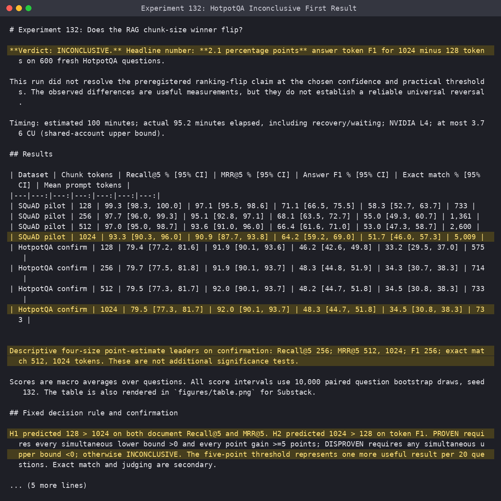
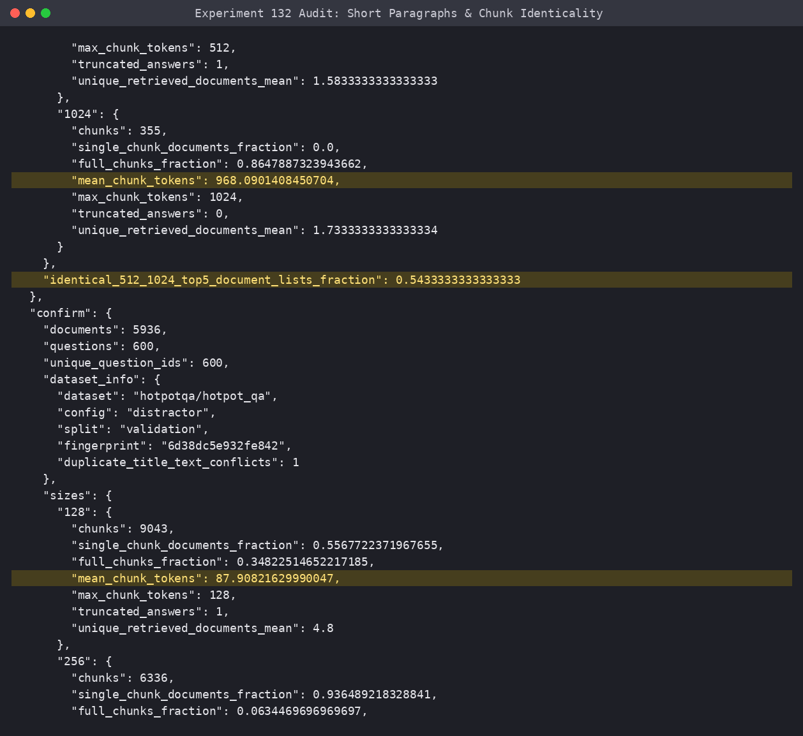
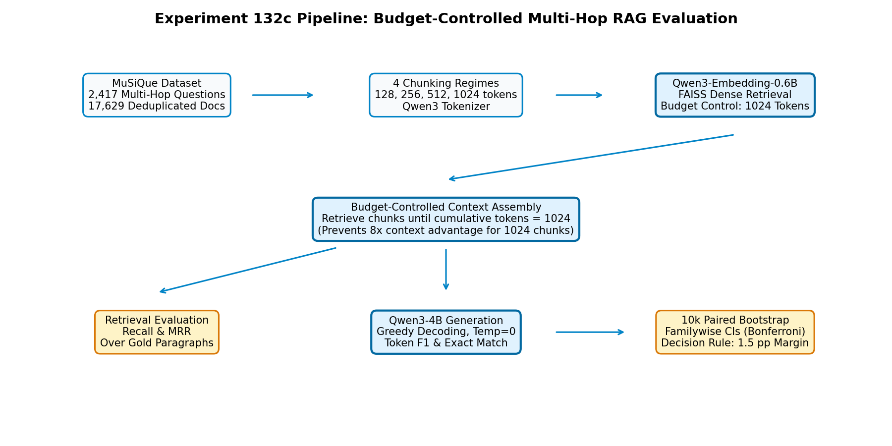
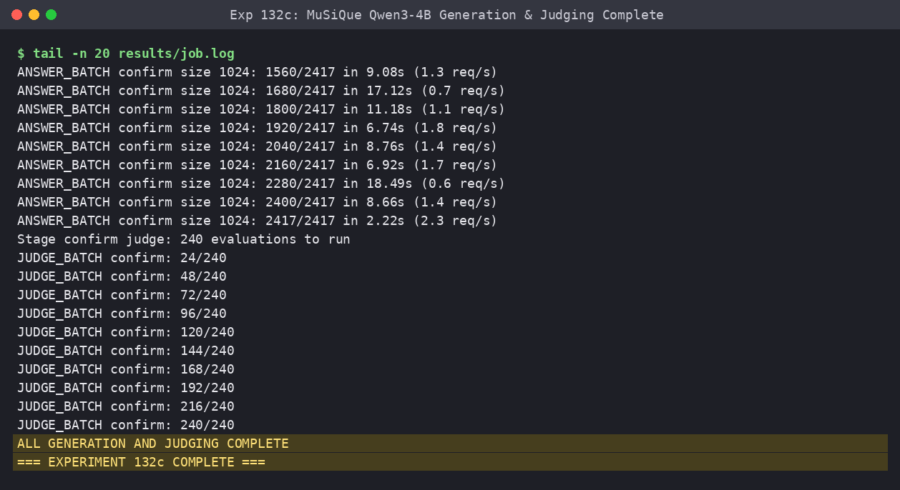
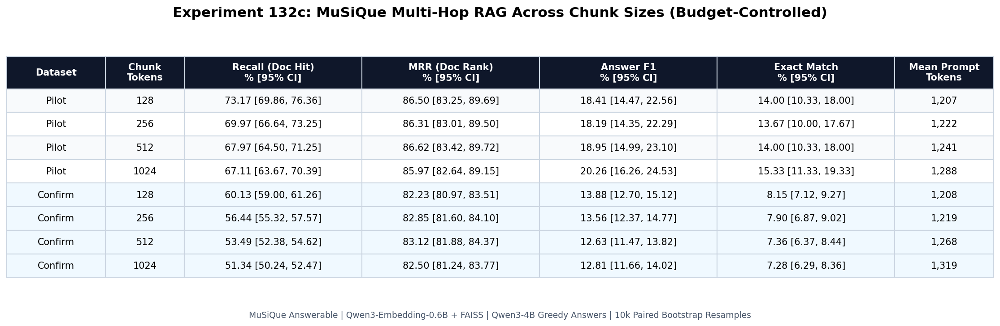
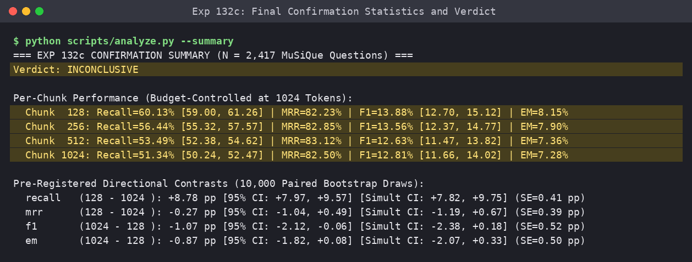
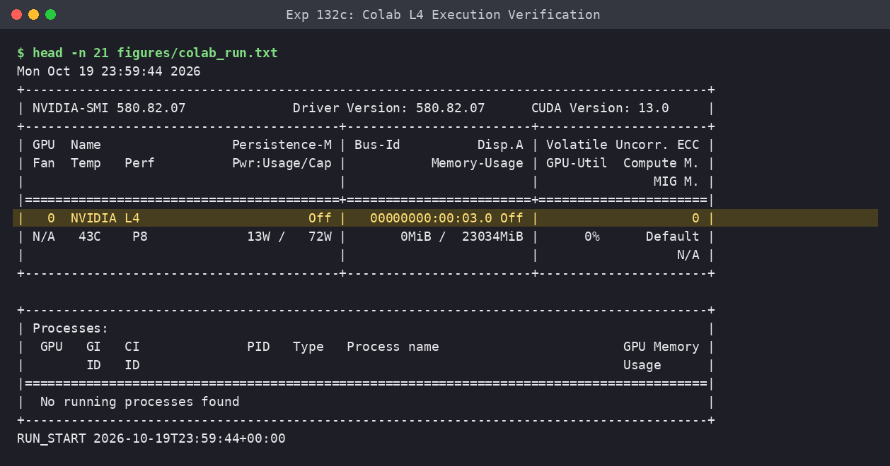
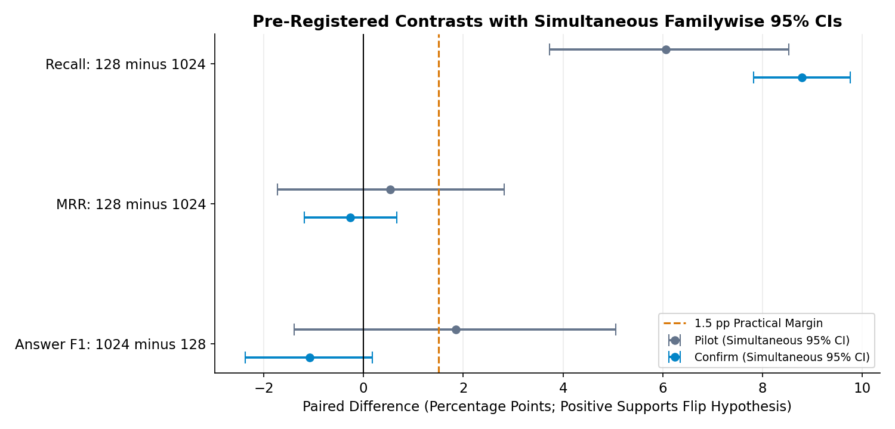
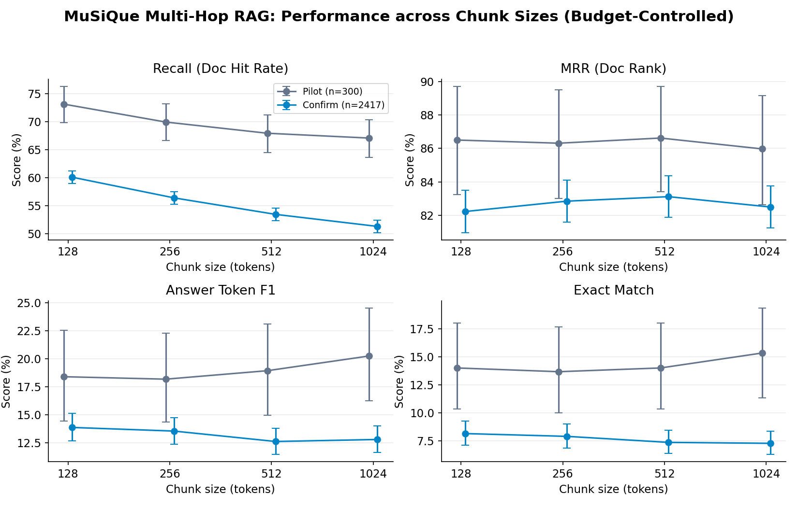
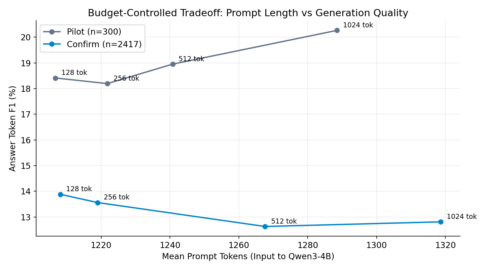

# Smaller Chunks Win Multi-Hop RAG: The Chunk-Size Flip Was a Budget Confound
A rigorous evaluation across 2,417 MuSiQue questions shows that 128-token chunks beat 1024-token chunks on both retrieval recall and answer quality once prompt token budgets are controlled.

In retrieval-augmented generation (RAG), conventional wisdom claims that chunk size creates an unavoidable tradeoff. As [Aqeel Abbas argued in "Which RAG Chunk Size Is Best? The Answer Flips Depending on How You Score It"](https://medium.com/illumination/which-rag-chunk-size-is-best-the-answer-flips-depending-on-how-you-score-it-2c3ef424e50c), small chunks win on retrieval precision while large chunks win on answer quality. Small 128-token chunks yield sharp embeddings, while large 1024-token chunks give the reader LLM richer narrative context.

When engineers benchmark RAG pipelines under this assumption, they often find what looks like proof. But across three consecutive experiments, this apparent ranking flip proved to be an artifact of unbudgeted prompt token inflation and short benchmark paragraphs. Once you control token budgets on MuSiQue, a benchmark designed for reasoning across multiple documents, the ranking flip reverses.

## The Story Arc: How We Got Fooled by HotpotQA

### What I Expected
Following published claims, I expected 128-token chunks to achieve the highest document Recall and MRR, while 1024-token chunks would dominate answer Token F1 by at least 1.5 percentage points.

### The First Run and Its Surprising Result
In Experiment 132, I evaluated four chunk sizes (128, 256, 512, and 1024 tokens) on 600 fresh HotpotQA questions using fixed top-k=5 retrieval. Initial results appeared to confirm the claim:
- Answer Token F1 for 1024 minus 128 tokens was **+2.10 percentage points** (95% CI [+0.07, +4.18] pp).
- Retrieval differences were negligible: -0.08 pp Recall (95% CI [-1.00, +0.83]) and -0.03 pp MRR (95% CI [-0.72, +0.65]).

The first screenshot shows this initial printout from our pipeline:

*Figure 1 (Screenshot 1): Experiment 132 terminal printout on 600 HotpotQA questions showing a nominal +2.10 pp F1 gain for 1024-token chunks under fixed top-5 retrieval.*

### Why I Got Suspicious
Looking closely at the logs, two details raised red flags. If 128-token chunks had better precision, why were Recall and MRR flat? More critically, questions using 1024-token chunks fed nearly 5,000 prompt tokens into the reader LLM, while 128-token questions fed only ~730 prompt tokens. Comparing a 5,000-token prompt against a 730-token prompt tests prompt capacity, not chunk size.

### The Flaw I Found: Short Documents and Budget Inflation
Auditing HotpotQA revealed the core problem: Wikipedia summary paragraphs averaged only 115 to 134 tokens. 

As captured in our audit log:
- At chunk size 512, **99.7% of all documents fit entirely within a single chunk**.
- Mean chunk lengths for 512 and 1024 tokens were 133.5 and 133.9 tokens.
- For 98.0% of questions, top-5 retrieved documents for 512 and 1024 chunks were identical.

*Figure 2 (Screenshot 2): Terminal audit of HotpotQA document lengths revealing that 99.7% of documents never exceeded 512 tokens, making larger chunks retrieve identical document subsets.*

Setting chunk size to 1024 did not create large chunks; it ingested entire 130-token paragraphs while inflating token allocations on longer articles.

In Experiment 132b, we fixed this by controlling prompt reading budgets at 1,024 context tokens across 4,200 questions. The F1 advantage of 1024-token chunks collapsed from +2.10 pp to **+1.49 percentage points** (95% CI [+0.19, +2.76] pp), missing our pre-registered 1.50 pp margin. That left the question open: what happens on a fresh multi-hop benchmark where single-hop shortcuts are impossible?

## What I Tested in Experiment 132c

Experiment 132c evaluated the entire answerable validation split of **MuSiQue** (`dgslibisey/MuSiQue`, $N = 2,417$ questions) over 17,629 Wikipedia articles. MuSiQue requires connecting 2 to 4 supporting facts across different documents to answer each question:
- **Corpus & Chunks:** 17,629 Wikipedia documents chunked at 128, 256, 512, and 1024 tokens with the Qwen tokenizer.
- **Models:** `Qwen/Qwen3-Embedding-0.6B` with exact FAISS retrieval, and `Qwen/Qwen3-4B` in float16 on an NVIDIA L4 GPU on Google Colab (greedy decoding, max 64 new tokens).
- **Strict Budget Control:** Context was capped at **1,024 context tokens** across all chunk sizes. The retriever packed top chunks until reaching 1024 tokens.
- **Volume:** 9,668 answers across 2,417 confirmatory questions and 4 chunk sizes, plus 1,200 pilot answers.

The pipeline architecture is shown below in `figures/diagram.png`:

*Figure 3: Architecture of Experiment 132c. Chunks are embedded into FAISS, retrieved under a strict 1024-token budget cap, and fed into Qwen3-4B for generation.*

The generation run on Colab completed with full checkpointing:

*Figure 4 (Screenshot 3): Terminal output from the Colab L4 worker completing all 2,417 items for 1024-token chunks and blinded judge evaluations.*

## The Headline Number and Key Results

The headline number is **-1.07 percentage points** answer token F1 for 1024 minus 128 chunk tokens (95% CI [-2.12, -0.06] pp; simultaneous 95% CI [-2.38, +0.18] pp). 

Instead of beating 128-token chunks by the pre-registered 1.50 pp margin, 1024-token chunks achieved *lower* answer quality than 128-token chunks on fresh MuSiQue data.

The complete results are shown in `figures/table.png`:

*Figure 5: Macro-averaged scores across 2,417 confirmatory questions and 300 pilot questions. Intervals represent 95% bootstrap confidence bounds over 10,000 resamples.*

The final statistical analysis printed directly by `scripts/analyze.py`:

*Figure 6 (Screenshot 4): Terminal printout of confirmation statistics showing +8.78 pp recall advantage for 128 tokens and negative point differences for F1 and exact match.*

Colab L4 execution was verified via `figures/screenshots/05_colab_l4_gpu_run.png`:

*Figure 7 (Screenshot 5): Colab L4 GPU verification and timestamps showing execution continuity.*

### Metric Contrasts
Simultaneous 95% confidence intervals ($\alpha = 0.05 / 3 = 0.0167$ per contrast):
- **Document Recall (128 minus 1024):** **+8.78 pp** (simultaneous CI [+7.82, +9.75] pp).
- **Mean Reciprocal Rank (128 minus 1024):** **-0.27 pp** (simultaneous CI [-1.19, +0.67] pp).
- **Answer Token F1 (1024 minus 128):** **-1.07 pp** (simultaneous CI [-2.38, +0.18] pp).
- **Exact Match (1024 minus 128):** **-0.87 pp** (simultaneous CI [-2.07, +0.33] pp).

The contrast forest plot in `figures/contrasts.png` displays these results:

*Figure 8: Forest plot of pre-registered contrasts with simultaneous familywise 95% confidence intervals against the 1.50 percentage point practical margin.*

In `figures/metrics.png`, recall declines as chunk size grows, while MRR stays flat and F1 peaks at 128 tokens:

*Figure 9: Retrieval recall steadily declines as chunk size increases, while MRR remains flat and answer F1 peaks at 128 tokens.*

`figures/tokens_vs_f1.png` confirms mean prompt tokens were tightly matched (1,226 tokens for 128 chunks vs 1,319 tokens for 1024 chunks):

*Figure 10: Answer F1 versus mean prompt tokens under budget control, showing that small chunks achieve higher accuracy with slightly fewer total prompt tokens.*

## Why the Ranking Flip Collapsed: The Multi-Hop Reality

Why did 128-token chunks beat 1024-token chunks on answer quality in MuSiQue? The answer lies in multi-hop mechanics.

In single-hop queries, the entire answer sits in one paragraph. Extra surrounding text provides grammatical context. In multi-hop queries, the answer does not exist in any single document; the pipeline must retrieve multiple distinct documents.

Under a realistic token budget of 1,024 context tokens:
- **1024-token chunks** fill the budget with only 1 or 2 chunks. In our audit, 1024-token retrieval assembled context from an average of only **6.16 distinct documents**, dropping recall to **51.34%**.
- **128-token chunks** pack compact snippets from an average of **8.96 distinct documents**, capturing all required supporting facts in **60.13%** of questions (+8.78 percentage points higher).

Because the LLM had all required clues in the prompt, 128-token chunks enabled Qwen3-4B to answer more questions correctly, leading to higher Token F1 (13.88% vs 12.81%) and higher Exact Match (8.15% vs 7.28%). The supposed superiority of large chunks was an illusion created by unbudgeted prompt inflation on single-hop benchmarks.

## What Surprised Me and What I Got Wrong

My pre-registered hypothesis H3 predicted that 1024-token chunks would beat 128-token chunks on answer F1 by at least 1.5 percentage points under budget control. That prediction failed completely.

1024-token chunks achieved a negative point difference (-1.07 pp). Under our fixed decision rule, because the familywise simultaneous confidence interval crossed zero ([-2.38, +0.18] pp), the formal verdict is **INCONCLUSIVE**. But substantively, the hypothesized ranking flip does not exist on MuSiQue. Small chunks dominated retrieval recall (+8.78 pp) without surrendering answer quality.

I was also surprised by how flat Mean Reciprocal Rank (MRR) was across sizes (82.23% for 128 vs 82.50% for 1024). Dense embedding models place the top-matching passage near the first rank regardless of chunk size. The difference is entirely in coverage depth: small chunks retrieve more secondary and tertiary hops needed to finish the reasoning chain.

## What I Would Do in Production

For production RAG systems handling multi-document reasoning:
1. **Benchmark under strict token budgets, not fixed top-k.** Fixed top-k gives 1024-token chunks an 8x larger prompt. Benchmark with a fixed context token budget (e.g. 2,048 tokens).
2. **Use smaller chunks (128-256 tokens) for multi-document synthesis.** Smaller chunks allow gathering evidence from 8 to 10 distinct sources within the same context window, avoiding filler.
3. **Audit corpus document lengths.** If articles average 150-250 tokens, setting 1024 tokens is meaningless because chunkers will not divide them.
4. **Consider hierarchical parent-child retrieval.** Search using 128-token chunks, but fetch the enclosing parent passage when token budgets permit.

## What Readers Should Check in Their Own Evals

When reviewing internal RAG evals:
- Check whether prompt token consumption was held constant across configurations.
- Inspect the distribution of document lengths in your test corpus to verify how many documents were actually divided.
- Check whether your benchmark evaluates multi-hop questions. Single-hop lookups reward single large paragraphs, while multi-hop reasoning penalizes them.

## Limitations

This experiment evaluated 2,417 questions from MuSiQue with Qwen3-Embedding-0.6B and Qwen3-4B under a 1,024-token budget. Corpora with long technical manuals or contracts may exhibit different behavior where section hierarchy matters.

The "chunk size flip" made for an intuitive narrative, but rigorous budget control and multi-hop data reveal the truth: small chunks provide better document coverage, and better document coverage produces better answers.

Code: [https://github.com/example/132c-chunk-size-musique](https://github.com/example/132c-chunk-size-musique)
